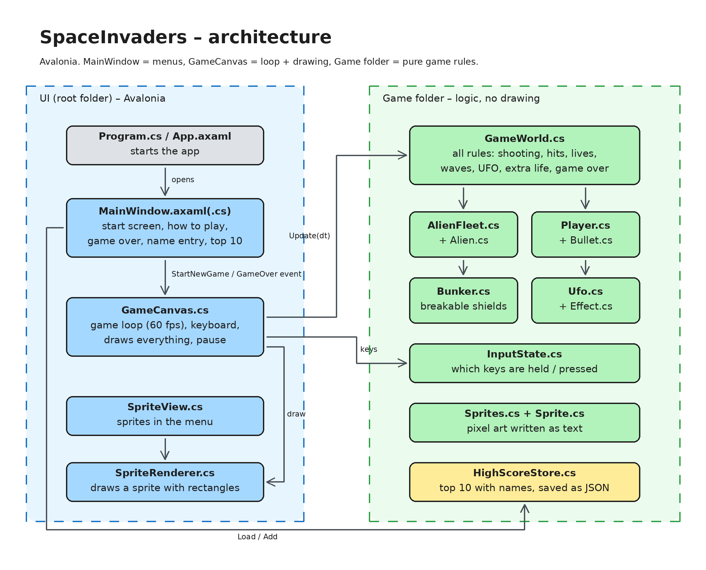

# Space Invaders

A Space Invaders–style arcade game built in C# with **Avalonia** (.NET 10).
Stop the alien fleet before it lands!



## Features

- 55 aliens in 5 rows that march sideways, drop down at the edge and speed up as their numbers shrink
- Three alien types worth 10, 20 and 30 points, with a two-frame walking animation
- Mystery ship (UFO) at the top worth 50–300 bonus points
- Four bunkers that break apart pixel by pixel when they are hit
- Aliens shoot back – only the lowest alien in each column can fire
- Your shot and an alien shot cancel each other out
- 3 lives, extra life every 1500 points
- New wave starts lower and faster each time
- Start screen with how-to-play and points table
- Pause screen
- Game over screen with name entry and a saved **Top 10** list
- All pixel art is drawn in code (no image files needed)

## How to play

| Key | Action |
|---|---|
| ← → / A D | Move |
| Space / W / ↑ | Shoot |
| P / Esc | Pause |
| Enter | Start / play again |

## Points

| Target | Points |
|---|---|
| Top row alien | 30 |
| Middle row alien | 20 |
| Bottom row alien | 10 |
| Mystery ship | 50, 100, 150 or 300 |

## Project structure

```
SpaceInvaders
├── Program.cs / App.axaml     starts the app
├── MainWindow.axaml(.cs)      menus: start screen, game over, name entry, top 10
├── GameCanvas.cs              game loop (60 fps), keyboard, draws everything, pause
├── SpriteView.cs              shows a sprite inside the menus
├── SpriteRenderer.cs          draws a sprite with rectangles
│
├── Game                       pure game logic – no drawing
│   ├── GameWorld.cs           all the rules: shooting, hits, lives, waves, UFO, game over
│   ├── AlienFleet.cs          moves the aliens together and picks who shoots
│   ├── Alien.cs               one alien (type, position, points)
│   ├── Player.cs              the player's ship
│   ├── Bullet.cs              player and alien shots
│   ├── Bunker.cs              breakable shields
│   ├── Ufo.cs                 the mystery ship
│   ├── Effect.cs              explosions and floating score text
│   ├── InputState.cs          which keys are held / pressed this frame
│   ├── Sprite.cs              pixel art made from text
│   ├── Sprites.cs             all the pixel art in the game
│   ├── GameConfig.cs          sizes and positions in one place
│   ├── Hitbox.cs              rectangle used for collisions
│   └── HighScoreStore.cs      top 10 with names, saved as JSON in AppData
│
└── docs                       architecture diagram (.png + .excalidraw)
```

## How it works

- **Virtual screen 640×360** – the game is drawn at a fixed size and scaled up to fit the window, so it looks the same on every screen.
- **Game loop with delta time** – `GameCanvas` runs ~60 times per second and tells `GameWorld` how many seconds have passed, so speed does not depend on frame rate.
- **Two layers** – `GameCanvas` draws the game, and the XAML menus lie on top in the same `Grid`. They are shown and hidden with `IsVisible`.
- **Event** – when the game is over, `GameCanvas` raises `GameOver(score)`. `MainWindow` decides what to show next.
- **Logic separated from drawing** – everything in the `Game` folder could be reused in another front-end (WinForms, console) without changes.

## How to run

```
dotnet run
```

The high score file is saved in `%AppData%\SpaceInvadersData\highscores.json`, so it is never pushed to GitHub.

## What I learned

- Custom rendering with Avalonia's `DrawingContext`
- A game loop with delta time and a virtual resolution
- Keeping game rules separate from drawing and menus
- Collision detection with rectangles
- Saving and loading data as JSON
